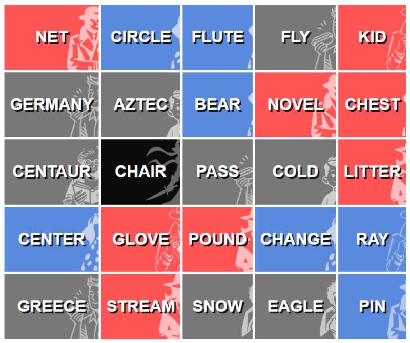
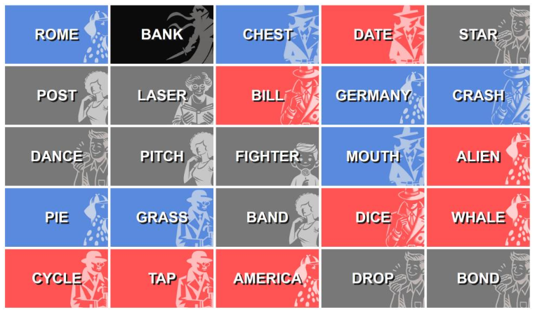

Per il primo articolo del mio blog volevo fare un passo indietro nel tempo e riprendere il mio primo progetto collaborativo sull'intelligenza artificiale: **Codenames-LLM**, sviluppato insieme a Francesco Marrocco nell'ambito del Percorso d'Eccellenza della nostra laurea triennale in Scienze Matematiche per l'Intelligenza Artificiale.

Il progetto nacque da un obiettivo semplice ma ambizioso: costruire un agente di intelligenza artificiale capace di giocare al gioco da tavolo *Codenames* usando quella che, all'epoca, era la più importante novità nel campo, cioè i **Large Language Model**.

Siamo stati affiancati da Antonio Norelli, ricercatore ed ex studente di Fisica e Informatica presso Sapienza Università di Roma. In quel periodo lavorava all'Università di Oxford sull'impiego del machine learning per contribuire a decifrare la comunicazione delle balene.

Antonio aveva già svolto una tesi dedicata alla costruzione di un valido giocatore artificiale per *Othello*, nella tradizione di sistemi come Deep Blue e AlphaGo. Come riferimento si può consultare [l'articolo relativo](https://doi.org/10.1109/TG.2022.3157345). Quel lavoro era stato supervisionato da Alessandro Panconesi, che ha seguito anche il nostro progetto su Codenames.

## Ma che cos'è Codenames?

*Codenames* è un gioco di associazioni tra parole disputato da due squadre avversarie, solitamente indicate come rossa e blu. Ogni squadra ha uno Spymaster e uno o più Operative. All'inizio della partita vengono disposte sul tavolo 25 parole. Ogni parola corrisponde a un'identità nascosta: alcune appartengono alla squadra rossa, altre alla blu, alcune sono neutrali e una è l'assassino.

Soltanto gli Spymaster vedono la corrispondenza completa tra parole e identità. Devono guidare la propria squadra a indovinare tutte le parole assegnate prima degli avversari, evitando quelle neutrali e soprattutto l'assassino, la cui selezione causa una sconfitta immediata.

A ogni turno, lo Spymaster fornisce un indizio composto da una sola parola e da un numero. L'indizio dovrebbe collegare più parole della propria squadra e il numero indica quante parole sono associate al concetto. Per esempio, un indizio come “Oceano 2” potrebbe suggerire che due parole della squadra sono legate all'oceano.

Gli Operative discutono e scelgono le parole una alla volta. Possono formulare un numero di ipotesi pari a quello indicato, più un'ipotesi aggiuntiva se desiderano rischiare sulla base di indizi precedenti. Dopo una risposta corretta possono continuare; scegliendo una parola neutrale o avversaria, il turno termina immediatamente; scegliendo l'assassino, la partita finisce con una sconfitta.

Dal punto di vista strategico, lo Spymaster deve bilanciare ambizione e sicurezza. Un indizio che collega molte parole può accelerare la partita, ma aumenta anche il rischio di ambiguità e associazioni involontarie. Un indizio prudente può essere più sicuro, ma anche più lento. Gli Operative devono interpretarlo considerando relazioni semantiche, indizi e risposte precedenti e il contesto complessivo della griglia. Devono inoltre decidere quando fermarsi per evitare rischi inutili.

Il gioco ruota quindi intorno a una comunicazione attenta, a una comprensione condivisa e alla capacità di ragionare su come gli altri interpretano il linguaggio. È un ambiente ricco e impegnativo sia per gli esseri umani sia per i sistemi di intelligenza artificiale. Se vuoi provarlo online con i tuoi amici, puoi usare [https://codenames.game/](https://codenames.game/).

## Perché Codenames era una sfida interessante per gli LLM

A prima vista, *Codenames* può sembrare un gioco di associazioni abbastanza semplice. In pratica richiede diverse capacità che erano particolarmente interessanti da studiare nei modelli linguistici:

- associazione semantica;
- ragionamento contestuale;
- gestione dell'ambiguità;
- teoria della mente;
- valutazione del rischio;
- comunicazione soggetta a vincoli rigidi;
- cooperazione tra giocatori con ruoli differenti.

Lo Spymaster deve trovare un indizio che colleghi più parole obiettivo evitando quelle avversarie e, soprattutto, l'assassino. L'Operative deve interpretare l'indizio cercando di ricostruire il ragionamento previsto dallo Spymaster.

Il gioco diventa così un ambiente naturale per studiare non soltanto le conoscenze linguistiche di un LLM, ma anche la sua capacità di ragionare, comunicare intenzioni e collaborare con un altro agente.

## Prompt engineering prima dei “reasoning model”

All'epoca, il prompt engineering era ancora oggetto di sperimentazione ed era considerato uno dei principali strumenti per migliorare l'affidabilità e le capacità di problem solving dei modelli linguistici.

Tecniche come il **Chain-of-Thought prompting** incoraggiavano un modello a scomporre il problema in passaggi intermedi di ragionamento prima di produrre una risposta finale. Oggi comportamenti simili vengono spesso discussi con termini più ampi come *ragionamento*, *deliberazione* o *calcolo in fase di inferenza*. Allora, invece, strutturare esplicitamente il prompt era uno dei modi più diretti per capire se un modello potesse andare oltre associazioni superficiali tra parole.

*Codenames* ci offriva un contesto interessante per provare queste idee. A uno Spymaster si poteva chiedere di:

1. analizzare le relazioni semantiche tra le parole sulla griglia;
2. individuare gruppi di parole obiettivo collegate;
3. valutare possibili associazioni con parole neutrali, avversarie e con l'assassino;
4. confrontare più indizi candidati;
5. scegliere l'indizio con il miglior equilibrio tra copertura e rischio.

Allo stesso modo, un Operative poteva essere invitato a esaminare l'indizio, ordinare le parole più plausibili e spiegare il ragionamento dietro ogni scelta.

L'esperimento non riguardava quindi soltanto la capacità di un LLM di sapere che due parole fossero collegate. Voleva anche verificare se un prompt progettato con cura potesse incoraggiare un'analisi più sistematica e strategica.

## Uno dei primi esperimenti di intelligenza artificiale agentica

Il progetto esplorava anche una domanda che da allora è diventata centrale nell'intelligenza artificiale agentica:

> Più agenti basati su modelli linguistici possono collaborare efficacemente quando ciascuno ha un ruolo, informazioni differenti e un obiettivo comune?

Invece di usare un unico modello per risolvere l'intera partita, il framework assegnava responsabilità diverse ad agenti diversi. Un agente agiva da Spymaster e generava indizi a partire dalle informazioni nascoste della griglia, mentre un altro agiva da Operative e interpretava gli indizi senza poter vedere lo stato completo del gioco.

Questa separazione creava un semplice sistema multi-agente. Gli agenti non si limitavano a produrre output indipendenti: la decisione di un agente diventava input e contesto per quello successivo.

La configurazione ci permetteva di esplorare varie domande:

- Due agenti potevano sviluppare una strategia condivisa efficace?
- Un Operative poteva ricostruire correttamente il ragionamento semantico del proprio Spymaster?
- Agenti basati sullo stesso modello collaboravano meglio di agenti basati su modelli differenti?
- Prompt con ragionamento esplicito miglioravano la coordinazione?
- Un modello poteva generare indizi tecnicamente validi ma difficili da comprendere per un altro modello?
- Un agente sapeva gestire l'incertezza e smettere di indovinare prima di una scelta pericolosa?

Oggi queste domande risultano familiari, perché i flussi multi-agente, i sistemi che usano strumenti e gli agenti autonomi sono diventati importanti ambiti di ricerca e sviluppo. All'epoca il nostro progetto era un esperimento in scala ridotta, volto a capire se la collaborazione tra agenti LLM con ruoli definiti potesse produrre un comportamento più strategico di una semplice sequenza di prompt isolati.

Sebbene il nostro obiettivo iniziale fosse creare un giocatore di Codenames realmente capace, il progetto si trasformò gradualmente in qualcosa di leggermente diverso: un benchmark e un articolo tecnico dai toni leggeri che confrontava alcuni dei modelli più avanzati disponibili in quel momento.

Purtroppo non pubblicammo mai l'articolo originale. La ricerca avanzava così velocemente che i risultati rischiavano di diventare obsoleti quasi subito. Nello stesso periodo iniziavano già ad apparire idee simili. Per esempio, un articolo su Medium presentava un torneo di Codenames tra LLM ([https://medium.com/data-science/llm-vs-llm-codenames-tournament-f8170dd1c8fb](https://medium.com/data-science/llm-vs-llm-codenames-tournament-f8170dd1c8fb)) e, più recentemente, un approccio correlato è stato formalizzato anche in un preprint ([https://arxiv.org/abs/2412.11373](https://arxiv.org/abs/2412.11373)). Da allora il ritmo ha continuato ad accelerare: persino gran parte della struttura di questo portfolio e del blog è stata scritta con l'aiuto di un agente di programmazione basato sull'intelligenza artificiale.

Eppure, quasi due anni dopo, riprendere il progetto offre un'interessante fotografia di ciò che i modelli linguistici sapevano e non sapevano fare in quel momento. Cattura anche una fase iniziale dell'evoluzione di idee oggi comunemente associate a reasoning model, orchestrazione dei prompt e intelligenza artificiale agentica.

Può inoltre offrire il punto di partenza per un nuovo esperimento. Potremmo ripetere lo stesso benchmark con l'ultima generazione di modelli e valutare quanto nettamente superino i predecessori, non soltanto per capacità linguistiche, ma anche per ragionamento strategico, gestione del rischio e coordinazione tra agenti.

## Come funziona il framework?

Il repository è organizzato intorno a un unico modulo Python, `codenamesLLM.py`, mentre i notebook forniscono punti di accesso interattivi, per Colab e per esperimenti su larga scala.

All'inizio di una partita, `generate_board()` scarica una lista di parole inglesi o italiane, estrae 25 parole uniche e assegna otto carte alla squadra rossa, sette alla blu, una all'assassino e le altre al gruppo neutrale. Dallo stesso stato vengono poi create due rappresentazioni: il prompt dello Spymaster include il colore nascosto di ogni parola, mentre gli Operative ricevono soltanto le parole rimanenti. Un dizionario parallelo di immagini genera la griglia coperta o la vista dello Spymaster con i colori rivelati.

Il livello API offre un'unica funzione di dispatch per i provider usati negli esperimenti: OpenAI, Anthropic, Google, xAI e un'API per Llama. Le risposte specifiche dei provider vengono normalizzate in dizionari Python, con una logica di nuovi tentativi per gli output strutturati non validi. In questo modo il ciclo di gioco poteva cambiare modello per nome mantenendo invariati i prompt dei ruoli e la rappresentazione dello stato.

L'agente Spymaster riceve la griglia colorata e la cronologia completa della partita. Il suo prompt di sistema spiega le regole, impone un indizio di una sola parola e un numero, avverte più volte di non usare una parola già presente sulla griglia e chiede al modello di ragionare su obiettivi, avversari e assassino. Con il Chain-of-Thought attivo, la risposta contiene anche un campo `thought`; senza, vengono restituiti soltanto `clue` e `number`. Il programma controlla autonomamente se l'indizio è presente sulla griglia e, in caso affermativo, ripete la richiesta registrando una violazione **Clue in Board**.

Il lato Operative supporta un solo agente oppure un gruppo di discussione. Un Operative singolo restituisce direttamente una parola, eventualmente con ragionamento esplicito. In un gruppo, ogni agente scrive prima una breve idea indipendente. Gli agenti vedono poi la conversazione accumulata e restituiscono tre valori: un messaggio per i compagni, un flag per richiedere un altro giro di discussione e un punteggio di fiducia da -10 a 10 per ogni parola ancora presente. `vote_system()` somma i dizionari dei punteggi e sceglie la parola con il valore più alto. Il ciclo si ripete una scelta alla volta fino al numero indicato dallo Spymaster, a meno che una carta neutrale o avversaria termini il turno oppure l'assassino termini la partita.

`play_turn()` risolve la carta selezionata, rimuove le parole rivelate, aggiorna i contatori delle carte rimanenti e aggiunge indizio e risultato alla cronologia condivisa. `play_game()` alterna i turni rossi e blu fino a quando una squadra rivela tutte le proprie carte o colpisce l'assassino. `play_game_mixed_guessers()` segue la stessa macchina a stati, ma consente a ogni posto da Operative di usare un modello differente.

I notebook racchiudono questo nucleo in tre modi:

- `PlayGame_local.ipynb` e `PlayGame_colab.ipynb` configurano le credenziali ed eseguono partite visibili tra umani o modelli;
- `PlayGame4Stats.ipynb` legge le configurazioni degli esperimenti da fogli di calcolo, esegue tornei ripetuti e salva vincitore, motivo della conclusione, turni, cronologia e conteggi Clue-in-Board dopo ogni partita;
- le celle di analisi aggregano i risultati di rosso e blu in percentuali di vittoria, esiti per completamento delle carte o assassino, dimensione media degli indizi, media delle risposte corrette e violazioni delle regole.

Questa separazione ha reso lo stesso motore utile come gioco interattivo, generatore di trascrizioni e strumento di confronto. Implementazione, notebook e dati sperimentali completi sono disponibili nel [repository Codenames-LLM](https://github.com/mich1803/Codenames-LLM).

## Quali risultati abbiamo ottenuto?

La relazione descrive quattro esperimenti collegati: modifica del numero di Operative collaborativi, combinazione di modelli differenti nella stessa squadra, verifica di prompt con ragionamento esplicito e svolgimento di un torneo tra modelli. Si trattava di esperimenti esclusivamente in inferenza, senza fine-tuning. Una partita tipica durava circa sei minuti e tutti gli agenti confrontati usavano la stessa struttura dei ruoli.

### Quanti agenti collaborativi?

Squadre basate su GPT-4o-mini, composte da uno a cinque Operative, hanno giocato 80 partite per ogni configurazione. Il risultato migliore è stato ottenuto con tre agenti:

| Operative | Percentuale di vittorie | Vittorie per completamento | Vittorie per assassino | Sconfitte per assassino |
| ---: | ---: | ---: | ---: | ---: |
| 1 | 46,25% | 14 | 23 | 17 |
| 2 | 48,75% | 19 | 20 | 23 |
| **3** | **60,00%** | **20** | **28** | **17** |
| 4 | 52,50% | 21 | 21 | 21 |
| 5 | 47,50% | 20 | 18 | 25 |

Il risultato non seguiva la regola “più agenti significa ragionamento migliore”. Passare da uno a tre aiutava, ma con quattro e cinque emergevano rendimenti decrescenti. Le trascrizioni mostrano il motivo: agenti aggiuntivi proponevano più interpretazioni, ma creavano anche classifiche contrastanti, discussioni più lunghe e situazioni in cui un'associazione debole riceveva sostegno soltanto perché più copie dello stesso modello la ripetevano.

### Le squadre miste di Operative erano utili?

Una squadra mista di tre agenti composta da Grok-beta, Claude 3.5 Sonnet e GPT-4o, con Grok-beta nel ruolo di Spymaster, è stata confrontata con squadre omogenee da tre agenti. Ha vinto il 43,75% delle partite contro Claude, il 43,75% contro GPT-4o e il 50% contro Grok-beta. La sola diversità non migliorava quindi le prestazioni: gli agenti erano differenti, ma condividevano lo stesso compito e non riuscivano a combinare con affidabilità i propri punti di forza.

La specializzazione dei ruoli ha avuto più successo. Grok-beta era lo Spymaster ad alte prestazioni più prudente, mentre Claude Sonnet era l'Operative più preciso. La combinazione di Grok come Spymaster e Claude come squadra di Operative ha raggiunto il 75% contro squadre omogenee Grok, il 62,5% contro GPT-4o e il 56,25% contro Claude. La lezione utile non era semplicemente aggiungere agenti eterogenei, ma assegnare i modelli ai ruoli nei quali il loro comportamento risultava migliore.

### Che cosa cambiava con il ragionamento esplicito?

Il risultato più chiaro sul prompting è emerso da 100 partite tra due Spymaster GPT-4o-mini. Entrambi ricevevano l'istruzione di ragionare sull'indizio, ma soltanto la condizione Chain-of-Thought offriva spazio sufficiente per articolare l'analisi prima della risposta.

| Prompt dello Spymaster | Percentuale di vittorie | Vittorie completando le carte | Sconfitte per assassino | Violazioni Clue-in-Board |
| --- | ---: | ---: | ---: | ---: |
| Senza CoT scritto | 39% | 13 | 28 | 71 |
| Con CoT scritto | **61%** | **33** | **26** | **11** |

Il ragionamento esplicito ha aumentato la percentuale di vittorie di 22 punti e ridotto drasticamente gli indizi non validi. In questo contesto il vantaggio non consisteva soltanto in associazioni semantiche più elaborate. La deliberazione aggiuntiva aiutava il modello a rispettare un fragile vincolo negativo: controllare l'intera griglia e non ripetere come indizio nessuna parola visibile.

### Quali modelli hanno ottenuto i risultati migliori?

Il torneo diretto ha confrontato ogni modello con gli stessi ruoli e condizioni di gioco:

| Modello | Percentuale di vittorie | Numero medio di risposte richieste | Media delle risposte corrette | Errori Clue-in-Board |
| --- | ---: | ---: | ---: | ---: |
| Grok-beta | **66,67%** | 1,770 | 0,876 | 2 |
| Claude 3.5 Sonnet | 64,81% | 2,234 | **0,942** | 0 |
| GPT-4o | 59,26% | 2,120 | 0,850 | 1 |
| Gemini 1.5 Pro | 55,56% | 2,199 | 0,829 | 0 |
| GPT-4o Mini | 53,70% | 2,092 | 0,698 | 4 |
| Claude 3.5 Haiku | 50,00% | 2,871 | 0,639 | 0 |
| Gemini 1.5 Flash | 48,15% | 2,129 | 0,778 | 2 |
| GPT-3.5 Turbo | 42,59% | 2,804 | 0,697 | 2 |
| Llama 3.2 90B | 37,04% | 2,466 | 0,740 | 0 |
| Llama 3.2 11B | 22,22% | 2,863 | 0,469 | 51 |

Grok-beta ha raggiunto la percentuale di vittorie più alta con indizi relativamente prudenti. Claude 3.5 Sonnet si è classificato subito dopo, non ha mai copiato una parola della griglia come indizio e ha ottenuto il maggior numero medio di risposte corrette per indizio. All'estremo opposto, Llama 3.2 11B ha unito la percentuale di vittorie più bassa a 51 violazioni delle regole. Nel torneo, il successo dipendeva dall'equilibrio tra portata semantica, prudenza, affidabilità degli output strutturati e rispetto esatto delle regole.

I risultati vanno letti come una fotografia di specifiche versioni dei modelli, prompt, provider e dimensioni dei campioni alla fine del 2024, non come una classifica valida per sempre. Proprio questo rende interessante riprendere l'esperimento: il framework ha registrato differenze comportamentali che un benchmark statico a domanda e risposta non avrebbe rilevato, compreso il modo in cui l'indizio di un agente modificava il ragionamento di un altro diverse chiamate più tardi.

## Partite di esempio

Per concludere mostriamo due delle partite che abbiamo giocato. Puoi trovarne altre in [https://github.com/mich1803/Codenames-LLM/tree/main/experiment_attempts](https://github.com/mich1803/Codenames-LLM/tree/main/experiment_attempts), oppure provarlo con il notebook nel repository se disponi di una chiave API per i modelli.

### Claude Haiku contro Claude Sonnet: quando il consenso ti rende meno intelligente

**Legenda:** 🔴 Squadra rossa · 🔵 Squadra blu · ⚪ Neutrale · ⚫ Assassino

La squadra rossa usava Claude 3.5 Haiku sia come Spymaster sia per i tre Operative; la squadra blu usava Claude 3.5 Sonnet nella stessa configurazione a tre Operative. Il rosso iniziava con otto parole, il blu con sette.

#### Considerazioni rapide

La partita è quasi un piccolo catalogo delle modalità di fallimento dei sistemi multi-agente. Gli agenti erano eccellenti quando il legame semantico era diretto: `BODY` portava a CHEST e KID, `GEOMETRY` a CIRCLE, CENTER e RAY, `MUSIC` a FLUTE e `NEEDLE` a PIN. I problemi iniziavano una volta esaurite le risposte ovvie, mentre il framework si aspettava ancora un'altra scelta.

Il titolo dell'esempio nasce dalla quarta scelta per `GEOMETRY`. Tutti e tre gli Operative Sonnet hanno menzionato GERMANY in modo indipendente e poi trasformato la ripetizione in fiducia: la somiglianza lessicale (`geo`), l'ingegneria di precisione e un vago collegamento storico sono diventati gradualmente un “accordo unanime sostenuto da un ragionamento solido”. La discussione non ha aggiunto prove, ma ha fatto sembrare più sicura la stessa associazione debole. Il risultato è stato una carta neutrale.

La squadra rossa si è avvicinata ancora di più al disastro. Con `BODY`, un agente Haiku ha proposto CHAIR, l'assassino, a causa della postura. Con `ORDER`, un altro agente ha sostenuto di nuovo CHAIR e l'ha ripetuto nel secondo giro di discussione. Il voto di fiducia ha selezionato AZTEC, ma il consenso non seguiva in modo affidabile la sicurezza. Più tardi, `MUSIC 3` di Sonnet ha promesso troppo: dopo l'ovvio FLUTE, gli Operative si sono convinti di NET per la somiglianza con “note”, regalando una carta al rosso. Haiku ha commesso l'errore simmetrico con `PRINT`, scegliendo la parola blu CHANGE tramite l'associazione con la stampa di denaro.

Sonnet ha vinto perché l'ultimo indizio è diventato prudente quando rimaneva una sola carta. `NEEDLE 1` ha eliminato la necessità di negoziare e prodotto una scelta unanime e corretta di PIN. La lezione generale è che la collaborazione aiutava soprattutto quando gli agenti portavano prove realmente diverse e fondate. Quando si limitavano a ripetersi, la discussione poteva amplificare una prima associazione sbagliata.

### **Umano contro GPT-4o Mini: lo Spymaster che indicò direttamente l'assassino**

**Legenda:** 🔴 Squadra rossa · 🔵 Squadra blu · ⚪ Neutrale · ⚫ Assassino

L'umano controllava lo Spymaster rosso e le risposte della squadra. GPT-4o Mini controllava lo Spymaster blu e tre Operative blu. Il rosso iniziava con otto carte e il blu con sette.

#### Considerazioni rapide

Questa sconfitta è iniziata prima del voto degli Operative. Lo Spymaster blu aveva identificato esplicitamente BANK come assassino e aveva scritto di dover essere “particolarmente prudente”. Ha comunque scelto `TREASURE 3`, un indizio con una fortissima associazione nel linguaggio comune sia con CHEST sia con BANK. I suoi obiettivi dichiarati dopo CHEST, cioè CRASH e PIE, erano molto più deboli dell'alternativa vietata che aveva già notato.

Gli Operative hanno poi agito in modo coerente con l'indizio ricevuto. Tutti e tre hanno menzionato BANK durante la prima discussione su CHEST, pur dando giustamente priorità a CHEST. Alla seconda scelta hanno classificato BANK al primo posto in modo indipendente e il giro aggiuntivo di discussione ha soltanto rafforzato la decisione. Date le loro informazioni, non si trattava di un'allucinazione inspiegabile: il pericolo nascosto derivava direttamente dall'indizio dello Spymaster.

La partita distingue quindi due forme di rispetto delle regole. GPT-4o Mini ha seguito correttamente il vincolo superficiale secondo cui l'indizio non poteva essere una parola della griglia, ma ha fallito quello strategico, che richiedeva un indizio le cui interpretazioni più probabili evitassero l'assassino. Lo Spymaster disponeva dell'informazione necessaria e l'aveva persino verbalizzata; l'analisi esplicita non garantiva che l'azione finale fosse coerente con essa.

La squadra umana ha commesso lo stesso tipo generale di errore, ma su scala minore. `WATER 2` ha trovato correttamente WHALE prima di regalare GRASS al blu, mentre `DEMOCRACY 2` ha trovato AMERICA prima di regalare GERMANY. Gli indizi ambiziosi associati a più parole aumentavano la copertura, ma né l'umano né il modello si fermavano dopo la risposta più sicura. La differenza è che l'eccesso di rischio del modello ha concluso la partita perché il suo indizio puntava proprio alla parola che avrebbe dovuto escludere più di ogni altra.

## Quali risultati otterremmo oggi?

**Prossimamente...**
